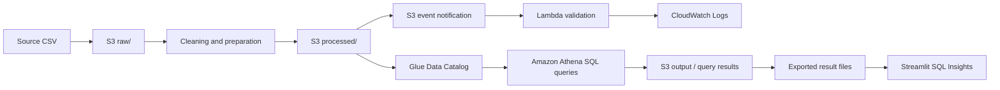

# AWS Customer Churn Prediction and Analytics

A data science project that explores telecommunications customer churn, compares machine-learning classifiers, analyses customer segments with SQL, and presents results through an interactive Streamlit dashboard. AWS services support cloud data storage, validation, metadata cataloguing, SQL analytics, and monitoring.

## Project Objectives

- Clean and validate the telecommunications customer churn dataset.
- Explore churn patterns using visualisations and descriptive statistics.
- Train and compare classification models for predicting customer churn.
- Analyse customer segments using Amazon Athena SQL queries.
- Organise project data in Amazon S3 and document the AWS workflow.
- Provide an interactive Streamlit UI for exploring churn and demonstrating predictions.

## Dataset

The project uses the public **Telecom Customer Churn** dataset from Kaggle:

- Source: [Telecom Customer Churn — Kaggle](https://www.kaggle.com/datasets/alipakzad/telecom-customer-churn)
- Original data: **7,043 rows and 20 columns**
- After cleaning: **7,021 rows and 20 columns**
- Target column: `Churn`

Download the dataset from Kaggle and follow its applicable terms. Do not commit secrets, AWS credentials, or private account information to this repository.

## Data Preparation and Quality Checks

The recorded cleaning workflow includes:

1. Convert blank `TotalCharges` values to numeric values.
2. Set blank `TotalCharges` to zero for zero-tenure records, where appropriate.
3. Remove **22 duplicate records**.
4. Check for missing values after cleaning.
5. Separate `Churn` as the target and exclude customer identifiers from model predictors.
6. Apply categorical encoding and numeric preprocessing within the modelling pipeline to avoid fitting preprocessing on the test split.

### Final data quality summary

| Check | Result |
|---|---:|
| Original records | 7,043 |
| Duplicate records removed | 22 |
| Cleaned records | 7,021 |
| Columns in cleaned data | 20 |
| Missing values after cleaning | 0 |
| No churn | 5,164 (73.55%) |
| Churn | 1,857 (26.45%) |

## Exploratory Data Analysis

The EDA examines churn distribution and differences between retained and churned customers. Recorded findings include:

- **Contract type:** month-to-month customers have a 42.64% churn rate, compared with 11.27% for one-year contracts and 2.83% for two-year contracts.
- **Tenure:** churned customers have an average tenure of 18.09 months, compared with 37.64 months for customers who did not churn.
- **Monthly charges:** churned customers have average monthly charges of 74.60, compared with 61.34 for customers who did not churn.
- **Payment method:** customers using electronic checks have an observed churn rate of 45.15%.

These are observed associations in this dataset; they do not by themselves prove that a customer characteristic causes churn.

## Machine-Learning Models

The project explored four classification approaches:

- Logistic Regression
- Random Forest
- Gradient Boosting
- Support Vector Machine (SVM)

A stratified train/test split and five-fold cross-validation were used. Model evaluation includes accuracy, precision, recall, F1-score, and ROC-AUC because the target classes are imbalanced.

### Five-fold cross-validation results

| Model | Accuracy | Precision | Recall | F1-score | ROC-AUC |
|---|---:|---:|---:|---:|---:|
| Logistic Regression | 0.7479 | 0.5153 | 0.8024 | 0.6274 | 0.8454 |
| Random Forest | 0.7687 | 0.5564 | 0.6247 | 0.5884 | 0.8221 |
| Gradient Boosting | 0.8042 | 0.6658 | 0.5234 | 0.5854 | 0.8474 |
| SVM | 0.7489 | 0.5169 | 0.7824 | 0.6224 | 0.8261 |

Gradient Boosting had the highest cross-validation accuracy and ROC-AUC among these recorded model results. Logistic Regression had the highest recall, which can be important when the business priority is to identify as many potential churners as possible.

### Tuned Gradient Boosting test result

A separate threshold-tuning experiment selected a threshold of approximately **0.3227**. The reported held-out test metrics at that threshold were:

| Metric | Result |
|---|---:|
| Accuracy | 0.7751 |
| Precision | 0.5591 |
| Recall | 0.7124 |
| F1-score | 0.6265 |
| ROC-AUC | 0.8396 |

These test results are separate from the five-fold cross-validation table above and should not be compared as if they came from the same evaluation procedure.

## AWS Architecture and Data Workflow

The recorded AWS workflow uses:

- **Amazon S3** for raw, processed, and output data.
- **AWS Lambda** for event-triggered data validation.
- **Amazon CloudWatch Logs** for Lambda execution logs.
- **AWS Glue Data Catalog** for dataset metadata.
- **Amazon Athena** for serverless SQL analysis over data in S3.

The S3 bucket recorded during development is `aws-customer-churn-project-2026` in the `ap-southeast-2` (Sydney) region. The bucket is organised with `raw/`, `processed/`, and `output/` prefixes. Do not share account IDs, credentials, or other sensitive AWS information in this README.

### Workflow



The recorded Lambda validation test passed for the cleaned dataset with 7,021 rows and 20 columns, with zero missing-value rows and zero duplicate rows. Ensure this description and any submitted evidence match the final AWS configuration.

## Amazon Athena SQL Analytics

The project includes SQL analyses for customer churn patterns, including:

1. Overall churn summary and churn rate.
2. Churn by contract type.
3. Churn by payment method.
4. Churn by internet service.
5. Churn by tenure group.
6. Average tenure and charges by churn status.

The SQL source file is expected at `sql/churn_analysis.sql`. Update the query list if the submitted SQL file differs from this description. Include verified query outputs in the technical report or project evidence.

## Streamlit Dashboard

The Streamlit interface includes these pages:

- **Overview** — high-level dataset and churn summary.
- **Explore Churn** — interactive exploration of churn patterns.
- **Predict Churn** — demonstration of churn-risk prediction for an entered customer profile.
- **Data Quality** — overview of data quality checks.
- **SQL Insights** — displays exported Athena query results.

### Important connection note

In the current recorded version, the SQL Insights page reads **exported Athena result files**. It does not execute live Athena queries directly from the dashboard unless that integration has since been added. Describe hosting as local unless an AWS deployment has been completed and tested.

## Run the Dashboard Locally

Prerequisites: Python and pip.

1. Clone the repository:

   ```bash
   git clone https://github.com/<YOUR-USERNAME>/AWS-Customer-Churn-Prediction.git
   cd AWS-Customer-Churn-Prediction
   ```

2. Open the dashboard folder and install dependencies:

   ```bash
   cd dashboard
   python -m pip install -r requirements.txt
   ```

3. Start the app:

   ```bash
   python -m streamlit run app.py
   ```

4. Open the local URL printed in the terminal, usually `http://localhost:8501`.

If your repository uses a different folder structure, adjust the commands to match it. Keep required CSV exports and model assets in the locations expected by `dashboard/app.py`.

## Repository Structure

The following is the intended high-level organisation; adapt it to match the files actually committed to GitHub.

```text
AWS-Customer-Churn-Prediction/
├── dashboard/
│   ├── app.py
│   ├── requirements.txt
│   └── data and exported query-result files
├── notebooks/
│   ├── data preparation and EDA notebook(s)
│   └── machine-learning notebook(s)
├── sql/
│   └── churn_analysis.sql
├── README.md
└── .gitignore
```

Only include folders and files that exist in the final repository. Avoid committing large temporary files, local virtual environments, credentials, or unrelated outputs.

## Business Recommendations

Based on the recorded analysis:

1. Prioritise month-to-month customers for retention experiments.
2. Improve onboarding and follow-up during the first year of a customer's tenure.
3. Investigate the experience of electronic-check users and customers with higher monthly charges.
4. Use model scores to help prioritise follow-up, and evaluate retention actions using measured outcomes.

Recommendations should be tested against business outcomes; observed correlations do not establish causation.

## Security and Cost Awareness

- Keep S3 Block Public Access enabled unless public access is explicitly required and approved.
- Use least-privilege IAM permissions for the required buckets, prefixes, and services.
- Do not commit AWS access keys, secrets, or tokens.
- Review CloudWatch logs for validation errors and troubleshooting.
- Monitor AWS Billing and Cost Management; configure a budget alert if one has not already been configured.
- Remove temporary cloud resources that are no longer needed.

## Team Contributions

Verify the student IDs and contribution descriptions with your group before submitting this README.

| Student Username | Contribution |
|---|---|
| MalshanJayathissa | Data preprocessing and EDA |
| PHGNKavindya | Model development, testing and deployment work as actually completed |
| Chama1010 | Athena SQL, AWS storage, validation and monitoring |
| RandinuGamage | Dashboard UI and testing |

## References

- Pakzad, A. [Telecom Customer Churn — Kaggle](https://www.kaggle.com/datasets/alipakzad/telecom-customer-churn)
- [Amazon S3 Documentation](https://docs.aws.amazon.com/s3/)
- [AWS Lambda Developer Guide](https://docs.aws.amazon.com/lambda/)
- [AWS Glue Documentation](https://docs.aws.amazon.com/glue/)
- [Amazon Athena User Guide](https://docs.aws.amazon.com/athena/)
- [Streamlit Documentation](https://docs.streamlit.io/)
- [Scikit-learn User Guide](https://scikit-learn.org/stable/user_guide.html)

---

