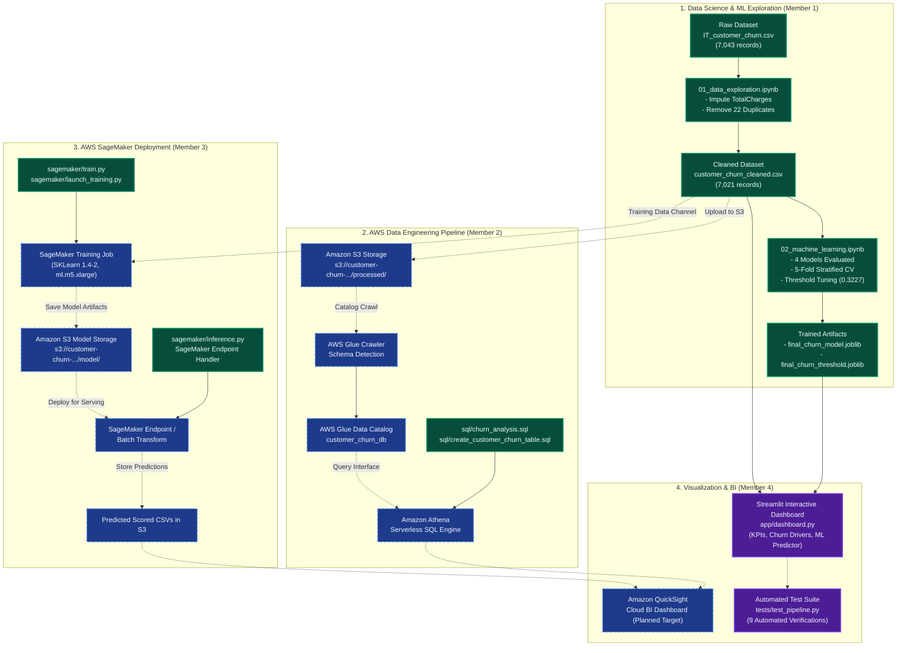

# End-to-End System Architecture: AWS Customer Churn Prediction

## 1. Executive Architecture Overview

The **AWS Customer Churn Prediction** system combines modern data engineering, machine learning pipelines, and business intelligence visualization to identify at-risk telecommunication customers and evaluate key churn drivers (contract duration, monthly charges, customer tenure, and service subscriptions).

To maintain strict academic integrity and engineering honesty, this architecture specification clearly differentiates between **verified local implementations** and **planned AWS cloud services**.

---

## 2. Architecture Diagram

---

## 3. Component Details & Operational Boundaries

### Component 1: Data Preparation & Cleaning (Member 1)
* **Status:** `VERIFIED COMPLETE (Local)`
* **Primary Files:**
  * `data/raw/IT_customer_churn.csv`: Raw IBM Telco customer dataset containing 7,043 rows and 20 attributes.
  * `notebooks/01_data_exploration.ipynb`: Handles whitespace formatting in `TotalCharges`, sets missing values for 11 customers with 0 tenure to 0.0, and eliminates 22 exact duplicate records.
  * `data/processed/customer_churn_cleaned.csv`: Clean baseline dataset with 7,021 rows and 20 attributes (5,164 retained, 1,857 churned; 26.45% baseline churn rate).

### Component 2: Machine Learning Modeling & Artifacts (Member 1)
* **Status:** `VERIFIED COMPLETE (Local)`
* **Primary Files:**
  * `notebooks/02_machine_learning.ipynb`: Evaluated Logistic Regression, Random Forest, Gradient Boosting, and SVM using 80/20 stratified splits and 5-fold stratified cross-validation.
  * `data/output/final_churn_model.joblib`: Production Gradient Boosting pipeline featuring scikit-learn `ColumnTransformer` (OneHotEncoder for 15 categorical features, passthrough for 4 numerical features) and `GradientBoostingClassifier(n_estimators=200, learning_rate=0.05, max_depth=3)`.
  * `data/output/final_churn_threshold.joblib`: Calibrated decision threshold (**0.322712**) calculated via precision-recall cross-validation to maximize churn recall (71.24%) and F1-score (0.6265).
  * `data/output/model_comparison.csv` & `random_forest_feature_importance.csv`: Baseline benchmark metrics and feature rankings.

### Component 3: AWS Data Engineering (Member 2)
* **Status:** `PARTIALLY COMPLETE (Scripts Verified; Cloud Deployment Unverified)`
* **Primary Files & Planned Resources:**
  * `sql/churn_analysis.sql`: 6 analytical SQL queries calculating churn by contract, payment method, internet service, tenure bracket, and monthly charges.
  * `sql/create_customer_churn_table.sql`: Athena external table DDL mapping S3 CSV data using `OpenCSVSerde`.
  * `Amazon S3 Bucket` (`customer-churn-analytics-ash1010-2026`): Intended landing zone for `/processed/` data and `/athena-query-results/`.
  * `AWS Glue Data Catalog & Crawler`: Planned cataloging mechanism for database `customer_churn_db`.
  * `Amazon Athena`: Serverless interactive query engine executing Trino/Presto SQL over S3 data.

### Component 4: AWS SageMaker Deployment (Member 3)
* **Status:** `PARTIALLY COMPLETE (Scripts Verified; Cloud Deployment Unverified)`
* **Primary Files & Planned Resources:**
  * `sagemaker/train.py`: Self-contained training script reading `SM_CHANNEL_TRAIN` and writing artifacts to `SM_MODEL_DIR`.
  * `sagemaker/launch_training.py`: Boto3/SageMaker SDK launcher script specifying region `ap-southeast-2`, IAM role `CustomerChurnSageMakerExecutionRole`, and SKLearn estimator version `1.4-2`.
  * `sagemaker/inference.py`: SageMaker endpoint handler defining `model_fn`, `input_fn`, `predict_fn`, and `output_fn`.
  * `SageMaker Endpoint / Batch Transform`: Planned cloud inference target to score customer records and output predictions to S3.

### Component 5: Visualization & Local Interactive Dashboard (Member 4)
* **Status:** `VERIFIED COMPLETE (Local)`
* **Primary Files:**
  * `app/dashboard.py`: Interactive Streamlit and Plotly dashboard.
    * Real-time KPI cards: Total Customers, Churned Customers, Overall Churn Rate, Avg Monthly Charges, Avg Customer Tenure.
    * Segment analyses matching SQL queries: Contract, Payment Method, Internet Service, Tenure Group, Monthly Charges distribution.
    * Live ML Risk Predictor: Interactive scenario simulator utilizing `final_churn_model.joblib` and calibrated threshold (`0.322712`).
    * Model Benchmarks Tab: Displays offline evaluation metrics and feature importance charts.
    * Zero Cloud Dependency: Runs entirely offline on local compute.
  * `Amazon QuickSight (Planned Target)`: Cloud BI dashboard intended to query Athena datasets once cloud permissions are activated.

### Component 6: Automated Testing & Quality Assurance (Member 4)
* **Status:** `VERIFIED COMPLETE (Local)`
* **Primary Files:**
  * `tests/test_pipeline.py`: Comprehensive test suite containing 9 automated tests verifying dataset presence, schema integrity, target label distribution, KPI math, zero-division resilience, model inference, and privacy compliance.

---

## 4. Data Lineage & Privacy Considerations

1. **Denominators & Statistical Honesty:**
   * Overall churn rate is strictly calculated as `Churned Customers / Total Evaluated Customers * 100%`.
   * Model prediction outputs are never commingled with historical ground-truth labels.
2. **Privacy by Design:**
   * The cleaned dataset contains no personally identifiable information (PII) such as customer names, physical addresses, national identity numbers, or raw customer IDs.
   * Dashboard and documentation present aggregated summaries and anonymized feature vectors only.
